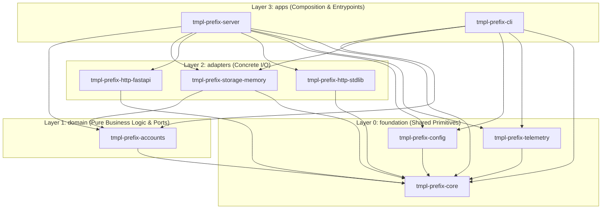

# 00-INDEX: Master Blueprint

Welcome to the
`tmpl-prefix` Python
`uv`-workspace monorepo. This
document is the single source of truth for humans and AI coding agents
working in this repository.

---

## 1. Quick Start

`uv` is the **only** host prerequisite. Install it if not already
present:

```bash
# macOS / Linux
curl -LsSf https://astral.sh/uv/install.sh | sh

# Windows (PowerShell)
powershell -ExecutionPolicy ByPass -c "irm https://astral.sh/uv/install.ps1 | iex"
```

Common workspace commands:

```bash
# Create .venv and install all workspace packages + dev tools
uv sync
# Run full quality gate, smoke checks, and wheel-install test
uv run xtask ci
# Enforce layer direction, AST imports, catalogue bounds, and lockfile
uv run xtask check
# Print workspace packages grouped by layer with internal dependencies
uv run xtask graph
# Start the HTTP server (FastAPI default; Ctrl+C to stop)
uv run tmpl-prefix-server
# Lifecycle health check using FastAPI adapter
uv run \
  tmpl-prefix-server \
  --check --http fastapi
# Lifecycle health check using stdlib adapter
uv run \
  tmpl-prefix-server \
  --check --http stdlib
# Run the CLI health subcommand
uv run tmpl-prefix \
  health
# Run unit and contract tests across all packages
uv run pytest
# Lint all packages and tooling with ruff ALL
uv run ruff check .
# Type-check all packages and tooling under mypy strict mode
uv run mypy
```

---

## 2. Annotated Folder Map

```text
.
├── 00-INDEX.md  # Master architectural & operational blueprint
├── AGENTS.md  # Concise guardrails and commands for AI coding agents
├── CONTRIBUTING.md  # Developer workflow and pull-request checklist
├── README.md                    # Project overview and quick start
├── pyproject.toml
    # Virtual workspace root, approved dependency catalogue, shared tool
    # config
├── uv.lock                      # Committed workspace lockfile
├── .env.example
    # Documented configuration defaults
├── .editorconfig                # Cross-editor formatting defaults
├── .gitignore  # Python, virtualenv, cache, and build exclusions
├── .worktreeinclude  # .env is not copied into worktrees; create it from .env.example
├── .github/
│   ├── CODEOWNERS               # Repository ownership map
│   ├── pull_request_template.md # PR verification checklist
│   └── workflows/
│       ├── ci.yml
    # Matrix CI (Python 3.13 + 3.x) running uv run xtask ci
│       └── release.yml  # Tag-triggered wheel build and artifact upload
├── docs/
│   └── adr/
│       ├── 0000-template.md  # Architecture Decision Record template
│       ├── 0001-layered-workspace.md
    # ADR 0001: Four-layer uv workspace architecture
│       └── 0002-http-adapter-pair.md
    # ADR 0002: Dual FastAPI / stdlib HTTP adapter seam
├── scripts/  # Shell and PowerShell helper scripts (created on first use)
├── templates/  # Scaffolder templates used by uv run xtask new-*
│   ├── component.py.tmpl
│   ├── test_component.py.tmpl
│   ├── package-lib/
│   └── package-app/
├── tools/
│   └── xtask/  # Zero-dependency stdlib platform automation package
│       ├── pyproject.toml
│       ├── src/xtask/
│       └── tests/
└── packages/
    ├── foundation/  # Layer 0: Shared primitives, zero business logic
    │   ├── tmpl-prefix-core/
    # Error taxonomy, Component/Registry, HttpServer port
    │   ├── tmpl-prefix-config/
    # Typed Settings via pydantic-settings
    │   └── tmpl-prefix-telemetry/
    # Structured JSON logger on stdlib logging
    ├── domain/  # Layer 1: Pure business logic & ports, zero I/O
    │   └── tmpl-prefix-accounts/
    # Account entity, AccountRepository port, AccountService
    ├── adapters/  # Layer 2: Concrete I/O implementations of ports
    │   ├── tmpl-prefix-storage-memory/
    # InMemoryAccountRepository (asyncio.Lock)
    │   ├── tmpl-prefix-http-fastapi/
    # FastApiHttpServer (in-process uvicorn)
    │   ├── tmpl-prefix-http-stdlib/
    # StdlibHttpServer (ThreadingHTTPServer -> event loop)
    │   └── tests/  # Shared parametrized adapter contract tests
    └── apps/  # Layer 3: Deployable entrypoints & composition roots
        ├── tmpl-prefix-server/
    # HTTP server binary (tmpl-prefix-server)
        └── tmpl-prefix-cli/
    # Administration CLI binary (tmpl-prefix)
```

---

## 3. Architectural Layers & Dependency Rule

The workspace is organized into four strict layers (`foundation` = 0,
`domain` = 1, `adapters` = 2, `apps` = 3).



### Dependency Rule Table

A package in layer **N** may depend on packages in layers **≤ N**.
Same-layer dependencies are allowed (except in `apps`), provided the
dependency graph remains strictly **acyclic**. Apps never depend on
apps.

| Layer        | Index | Directory               | Allowed Internal Target Layers                 | Same-Layer Deps Allowed?      |
| ------------ | ----- | ----------------------- | ---------------------------------------------- | ----------------------------- |
| `foundation` | 0     | `packages/foundation/*` | `foundation` (0)                               | Yes (must be acyclic)         |
| `domain`     | 1     | `packages/domain/*`     | `foundation` (0), `domain` (1)                 | Yes (must be acyclic)         |
| `adapters`   | 2     | `packages/adapters/*`   | `foundation` (0), `domain` (1), `adapters` (2) | Yes (must be acyclic)         |
| `apps`       | 3     | `packages/apps/*`       | `foundation` (0), `domain` (1), `adapters` (2) | **No** (apps are independent) |

Dev/test dependency groups are exempt from the direction rule **only**
for imports inside `tests/` and `*_test.py`. Production `src/` code is
never exempt.

Both `uv run xtask check` (manifest + AST source-import scanner + cycle
detector) and `uv run lint-imports` (`import-linter` contracts) enforce
this rule independently.

---

## 4. Modules vs. Components

- **Module (Workspace Package)**: A compile-time and packaging boundary
  under
  `packages/<layer>/tmpl-prefix-<name>/`
  with its own
  `pyproject.toml`,
  `src/tmpl_prefix_<name>/`,
  `py.typed`, and `tests/`.
- **Component (`Component` Protocol)**: A runtime lifecycle unit
  (`name`, `async start(ctx)`, `async stop()`,
  `async health() -> Health`) managed by `Registry`
  (`TmplPrefixRegistry`).
  - `Registry.start(ctx)` starts components in registration order. If
    any component raises an exception or `asyncio.CancelledError`,
    `Registry` rolls back already-started components in **reverse**
    order before re-raising.
  - `Registry.stop()` stops started components in **reverse** order.

---

## 5. Anatomy of a Domain Module

Every domain package (such as
`packages/domain/tmpl-prefix-accounts/src/tmpl_prefix_accounts/`)
follows a consistent five-file structure:

1. `__init__.py` — Re-exports the public domain surface (`__all__`).
2. `model.py` — Immutable value objects (`NewType`, validator functions
   like `parse_email()`) and frozen
   `@dataclass(frozen=True, slots=True)` entities (`Account` /
   `TmplPrefixAccount`).
3. `port.py` — `@runtime_checkable` `Protocol` interfaces defining
   outbound I/O seams (`AccountRepository` /
   `TmplPrefixAccountRepository`).
4. `service.py` — Pure business logic (`AccountService` /
   `TmplPrefixAccountService`)
   operating over ports and raising
   `AppError`
   (`TmplPrefixError`)
   with appropriate `ErrorKind` values.
5. `component.py` — Runtime `Component` wrapper (`AccountsComponent` /
   `TmplPrefixAccountsComponent`)
   participating in `Registry` startup,
   shutdown, and health reporting.

---

## 6. Layered Configuration Guide

All configuration lives in
`packages/foundation/tmpl-prefix-config`
(`tmpl_prefix_config.settings`):

1. **Typed Models**: `Settings`
   (`TmplPrefixSettings`)
   inherits from
   `pydantic_settings.BaseSettings` with `extra="forbid"`,
   `env_prefix="TMPL_PREFIX_"`,
   `env_nested_delimiter="__"`, and
   `env_file=".env"`.
2. **Per-Component Sub-Models**: `HttpSettings(host, port, adapter)` and
   `LogSettings(level)` are frozen Pydantic models nested under
   `Settings`.
3. **Precedence**:
   - Explicit `env` mapping passed to `load_settings(env={...})` (used
     in tests without touching `os.environ`).
   - Process environment variables
     (`TMPL_PREFIX_ENVIRONMENT`,
     `TMPL_PREFIX_HTTP__PORT`,
     `TMPL_PREFIX_HTTP__ADAPTER`,
     `TMPL_PREFIX_LOG__LEVEL`).
   - Local `.env` file at the workspace root.
   - Model field defaults in `Settings`.
4. **Error Aggregation**: `load_settings()` catches
   `pydantic.ValidationError` and raises a single
   `AppError(kind="config")` whose message and `details["fields"]` list
   every invalid field.

---

## 7. Step-by-Step Playbooks

### 7.1 Adding a Domain Module

```bash
uv run xtask new-package domain billing --description "Invoicing domain logic."
```

Then add `model.py`, `port.py`, `service.py`, and `component.py` inside
`packages/domain/tmpl-prefix-billing/src/tmpl_prefix_billing/`.

### 7.2 Adding a Runtime Component

```bash
uv run xtask new-component \
  tmpl-prefix-billing \
  invoice_sync --wire \
  tmpl-prefix-server
```

This generates `invoice_sync.py` and `tests/test_invoice_sync.py`,
exports `InvoiceSyncComponent`
(`TmplPrefixInvoiceSyncComponent`)
from
`__init__.py`, ensures
`tmpl-prefix-core` is a
dependency, and wires the
component into
`tmpl-prefix-server/src/tmpl_prefix_server/wiring.py`.

### 7.3 Adding an Adapter / Backend (Worked Example: `http-fastapi` vs. `http-stdlib`)

The template ships two concrete implementations of `HttpServer`
(`tmpl_prefix_core.http.HttpServer`):

- `packages/adapters/tmpl-prefix-http-fastapi`:
  Runs FastAPI + Uvicorn
  in-process (`Config(lifespan="off")`). Selected when
  `TMPL_PREFIX_HTTP__ADAPTER=fastapi`
  (default).
- `packages/adapters/tmpl-prefix-http-stdlib`:
  Runs
  `http.server.ThreadingHTTPServer` on a background thread and
  dispatches async route handlers onto the owning event loop via
  `asyncio.run_coroutine_threadsafe(coro, loop).result(timeout)`.
  Selected when
  `TMPL_PREFIX_HTTP__ADAPTER=stdlib`
  or `--http stdlib`.
- Both adapters are verified against the exact same parametrized
  contract suite in `packages/adapters/tests/test_http_contract.py`.
- To add another adapter (e.g.,
  `tmpl-prefix-storage-postgres`):
  1. Run

     ```bash
     uv run xtask new-package adapters storage-postgres \
       --description "PostgreSQL account repository."
     ```

  2. Add
     `"tmpl-prefix-accounts"`
     and
     `"tmpl-prefix-core"`
     to its
     `dependencies` and `[tool.uv.sources]`, plus `"asyncpg>=0.30,<1"`
     from the root catalogue.
  3. Implement `AccountRepository` and add it to the shared contract
     test.

### 7.4 Adding a Deployable App

```bash
uv run xtask new-package apps worker --app --description "Background queue worker."
```

This scaffolds an executable package under
`packages/apps/tmpl-prefix-worker/`
with `[project.scripts]` configured.

### 7.5 Adding a Foundation Package

```bash
uv run xtask new-package foundation crypto \
  --description "Deterministic hashing primitives."
```

### 7.6 Adding a Third-Party Dependency from the Workspace Catalogue

1. Locate the package's compatible-range specifier in root
   `pyproject.toml` under
   `# --- Approved Third-Party Catalogue (opt-in per package) ---`
   (`[tool.uv].constraint-dependencies`), e.g. `"httpx>=0.28,<1"`.
2. Copy the **exact specifier string** into the target package's
   `[project].dependencies` above `# @xtask:dependencies`. Bare names
   are forbidden so published wheel metadata always carries proper
   version bounds.
3. Run `uv sync` and `uv run xtask check`.

### 7.7 Adding a Config Setting

1. Add the typed field or frozen `BaseModel` sub-model to
   `packages/foundation/tmpl-prefix-config/src/tmpl_prefix_config/settings.py`.
2. Document the
   `TMPL_PREFIX_*` variable
   (using `__` for nested fields)
   in `.env.example`.
3. Add validation tests in
   `packages/foundation/tmpl-prefix-config/tests/test_config.py`.

---

## 8. Quality Gates & CI Matrix

Every change must pass `uv run xtask ci`:

1. `uv sync --locked`
2. `uv run ruff format --check .`
3. `uv run ruff check .` (`select = ["ALL"]`, `ANN401` enabled banning
   `Any`, `T201` restricted to `*/cli/output.py`)
4. `uv run mypy` (`strict = true`, `pydantic.mypy` plugin)
5. `uv run lint-imports` (`import-linter` four-layer and forbidden
   contracts)
6. `uv run pytest`
7. Check the standard-library HTTP adapter:

   ```bash
   uv run \
     tmpl-prefix-server \
     --check --http stdlib
   ```

8. Check the FastAPI HTTP adapter:

   ```bash
   uv run \
     tmpl-prefix-server \
     --check --http fastapi
   ```

9. `uv run pip-audit --strict --skip-editable` (skippable locally via
   `uv run xtask ci --offline`)
10. `uv run xtask check`
11. **Wheel-install smoke**: `uv build --all-packages`, fresh `uv venv`
    outside the workspace,
    `uv pip install --no-index --find-links dist tmpl-prefix-server`,
    and
    check the installed server:

    ```bash
    tmpl-prefix-server \
      --check --http stdlib
    ```

GitHub Actions (`.github/workflows/ci.yml`) runs this gate across Python
`3.13` (floor) and `3.x` (latest).

---

## 9. Complete `uv run xtask` Reference & Markers

| Command                                                                  | Description                                                                  |
| ------------------------------------------------------------------------ | ---------------------------------------------------------------------------- |
| `uv run xtask ci [--offline]`                                            | Full quality gate, server smoke checks, and wheel-install verification       |
| `uv run xtask check`                                                     | Validate layer rules, catalogue bounds, AST imports, naming, and `uv.lock`   |
| `uv run xtask graph`                                                     | Print package dependency tree by layer                                       |
| `uv run xtask new-package <layer> <name> [--app] [--description <text>]` | Scaffold a library or app package and register it in root config             |
| `uv run xtask new-component <package> <name> [--wire <app>]`             | Scaffold a `Component` + test and optionally wire it into an app             |
| `uv run xtask rename <new_prefix>`                                       | Context-aware four-form prefix rename across the entire workspace            |
| `uv run xtask bump-python <ver>`                                         | Rewrite Python version floor (`3.XX`) across manifests/CI and verify with CI |

### Required `# @xtask:...` Markers

Never delete these marker comments; `xtask` uses them for targeted line
edits:

- Root `pyproject.toml`: `# @xtask:known-first-party`,
  `# @xtask:mypy-path`, `# @xtask:root-packages`, `# @xtask:layer-apps`,
  `# @xtask:layer-adapters`, `# @xtask:layer-domain`,
  `# @xtask:layer-foundation`, `# @xtask:layers`,
  `# @xtask:forbidden-sources`, `# @xtask:forbidden-modules`.
- Package `pyproject.toml`: `# @xtask:dependencies`, `# @xtask:sources`.
- App `wiring.py`: `# @xtask:component-imports`,
  `# @xtask:register-components`.

---

## 10. Topology

- **One repository, one CI gate**: All services, CLIs, workers, and
  shared libraries live in this `uv` workspace.
- **Microservices**: Add another deployable under
  `packages/apps/tmpl-prefix-<app>`
  sharing `foundation`, `domain`, and
  `adapters` packages. Never split into separate repositories.
- **Publishable SDK**: A library package under `packages/` with a
  publish step in `.github/workflows/release.yml`.

---

## 11. Governance

- **Code Ownership**: `.github/CODEOWNERS` assigns default review
  ownership.
- **Architecture Decision Records**: Significant architectural choices
  are recorded under `docs/adr/` starting from
  `docs/adr/0000-template.md`.
- **Where new files go**: Notes and diagrams written at the root (`.md`,
  `.rst`, `.adoc`, `.mmd`, `.puml`, `.drawio`) move to `docs/`; decision
  records (`adr-*.md`, `0003-name.md`) move to `docs/adr/`. Root shell
  and PowerShell scripts (`.sh`, `.bash`, `.ps1`) move to `scripts/`.
  Code and tests are not moved, because the root cannot tell which
  package owns them: put them in a package yourself.
- **Pull Requests**: Every PR completes
  `.github/pull_request_template.md`.

---

## 12. Releases, Versioning, Publishing & Container-less Deploys

- **Versioning**: The virtual workspace root has no `[project]` table.
  Bump an individual package version with:

  ```bash
  uv version --package \
    tmpl-prefix-server \
    0.2.0
  ```

- **Building Wheels**:

  ```bash
  uv build --all-packages
  ```

  When publishing an internal SDK package to an index, publish it
  **together with every internal workspace package it depends on** so
  sibling wheel dependencies resolve cleanly.
- **Container-less Deployment**:

  ```bash
  uv sync --no-dev --locked
  uv run --no-dev \
    tmpl-prefix-server
  ```

---

## 13. Rebranding (`uv run xtask rename <new_prefix>`)

Rename all four placeholder forms
(`tmpl-prefix` kebab,
`tmpl_prefix_*`
snake, `TMPL_PREFIX_*`
screaming, `TmplPrefix*`
Pascal) in one command:

```bash
uv run xtask rename my_service
```

The renamer is context-aware and supports multi-word → single-word →
multi-word round-trips (e.g. `acme_cloud` → `zenith` → `my_service`).

---

## 14. Scaling Further

- **PostgreSQL Persistence**: Opt into `"asyncpg>=0.30,<1"` and
  `"sqlalchemy>=2.0,<3"` from the root catalogue in a new
  `packages/adapters/tmpl-prefix-storage-postgres`
  adapter.
- **Structured Logging / OpenTelemetry**: Opt into
  `"structlog>=24.4,<26"` in
  `tmpl-prefix-telemetry`
  while keeping the
  `Logger` Protocol unchanged.
- **Property-Based Testing**: Opt into `"hypothesis>=6.120,<7"` for
  domain invariant fuzzing.
- **Packaging & Containers**: Build multi-stage images or deploy wheels
  built via `uv build --all-packages`.

---

## 15. Troubleshooting FAQ

- **`uv lock --check` fails with lock drift**: Run `uv lock` or
  `uv sync` and commit the updated `uv.lock`.
- **`ModuleNotFoundError` for an internal package**: Verify the package
  is listed in both `[project].dependencies` and `[tool.uv.sources]`
  with `{ workspace = true }`, then run `uv sync`.
- **`mypy` strict errors on third-party libraries**: Prefer typed
  packages from the workspace catalogue or add targeted
  `[[tool.mypy.overrides]]` in root `pyproject.toml`.
- **`.env` values ignored in tests**: `load_settings(env={...})`
  intentionally ignores `.env` and `os.environ` when an explicit `env`
  mapping is passed so unit tests remain hermetic.
- **Windows path or signal quirks**: `loop.add_signal_handler` is
  POSIX-only;
  `tmpl-prefix-server`
  falls back to `signal.signal` on
  Windows automatically.
