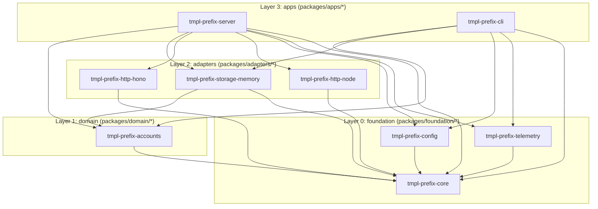

# 00-INDEX Platform Blueprint

Welcome to the
`tmpl-prefix` TypeScript /
Node.js workspace template.
This document is the single source of truth for both human engineers and
AI coding agents working in this repository.

---

## 1. Quick Start

> **Toolchain note:** Node 24 LTS (`>=24`) and `pnpm@12.15.0` are
> required. Do not rely on `corepack` (removed in Node >=25); install
> `pnpm` globally via:
>
> ```bash
> npm i -g pnpm@12.15.0
> ```

```bash
# Install workspace dependencies (offline-ready via pnpm store)
pnpm install

# Build all packages with TypeScript project references
pnpm build

# Run all compiled unit and contract tests via node:test
pnpm t

# Run Biome formatter + linter checks
pnpm lint

# Run architectural layer, manifest, and source-import guardrails
pnpm xtask check

# Run the complete CI gate (frozen-lockfile, biome, tsc -b, tests, smoke
# checks, xtask check)
pnpm xtask ci

# Start the HTTP server (Ctrl+C for graceful SIGINT shutdown)
pnpm server

# Run the CLI health command
pnpm cli -- health

# Print the layered dependency graph
pnpm xtask graph
```

---

## 2. Annotated Folder Map

```text
.
├── 00-INDEX.md  # Master architecture & operational blueprint
├── AGENTS.md  # Concise rules and commands for AI coding agents
├── README.md  # Project overview and quick-start instructions
├── CONTRIBUTING.md  # Contribution workflow and quality gates
├── package.json  # Private workspace root manifest and scripts
├── pnpm-workspace.yaml
    # Workspace globs + Approved Third-Party Catalogue
├── pnpm-lock.yaml  # Deterministic workspace lockfile
├── tsconfig.base.json
    # Strict erasable-syntax TypeScript compiler flags
├── tsconfig.json  # Root solution tsconfig with project references
├── biome.json  # Biome formatter and strict linter rules
├── .nvmrc                               # Node 24 LTS pin
├── .npmrc  # engine-strict, auto-install-peers, save-exact
├── .env.example
    # Documented configuration defaults
├── .worktreeinclude  # .env is not copied into worktrees; create it from .env.example
├── docs/adr/                            # Architecture Decision Records
│   ├── 0000-template.md
│   ├── 0001-layered-workspace.md
│   └── 0002-http-adapter-pair.md
├── .github/                             # Governance & CI workflows
│   ├── CODEOWNERS
│   ├── pull_request_template.md
│   └── workflows/
│       ├── ci.yml
│       └── release.yml
├── packages/
│   ├── foundation/  # Layer 0 — shared primitives, zero business rules
│   │   ├── tmpl-prefix-core/
    # AppError, Result, Component, Registry, HttpServer port
│   │   ├── tmpl-prefix-config/
    # Zod-validated Config from environment variables
│   │   └── tmpl-prefix-telemetry/
    # Zero-dep structured JSON key-value Logger
│   ├── domain/  # Layer 1 — pure business logic & ports, zero I/O
│   │   └── tmpl-prefix-accounts/
    # Account model, AccountRepository port, AccountService
│   ├── adapters/  # Layer 2 — concrete I/O implementations of ports
│   │   ├── tmpl-prefix-storage-memory/
    # In-memory Map-backed AccountRepository
│   │   ├── tmpl-prefix-http-hono/
    # Hono + @hono/node-server HttpServer (default)
│   │   └── tmpl-prefix-http-node/
    # Zero-dep node:http HttpServer + shared contract test
│   └── apps/  # Layer 3 — deployable entry points, composition only
│       ├── tmpl-prefix-server/
    # HTTP server composition root (/health, /live, /ready)
│       └── tmpl-prefix-cli/
    # CLI binary for accounts & health
├── scripts/  # Shell and PowerShell helper scripts (created on first use)
├── templates/  # Scaffolding templates consumed by `pnpm xtask`
│   ├── package-lib/
│   ├── package-app/
│   ├── component.ts.tmpl
│   └── component.test.ts.tmpl
└── tools/
    └── xtask/
    # Zero-dependency platform automation (`node tools/xtask/main.ts`)
```

---

## 3. The 4 Architectural Layers

Every workspace package under `packages/` belongs to one of four strict
layers:



### Dependency Rule Table

A package in layer **N** may depend on packages in layers **<= N**
(same-layer dependencies are allowed when acyclic). Apps never depend on
apps. `devDependencies` are exempt from the direction rule **only** for
imports inside `*.test.ts` files (never in production `src/` files) and
remain subject to cycle checks.

| Layer        | Number | Directory               | May Depend On (`dependencies`)               | Forbidden Dependencies       |
| :----------- | :----: | :---------------------- | :------------------------------------------- | :--------------------------- |
| `foundation` |   0    | `packages/foundation/*` | `foundation` (acyclic)                       | `domain`, `adapters`, `apps` |
| `domain`     |   1    | `packages/domain/*`     | `foundation`, `domain` (acyclic)             | `adapters`, `apps`           |
| `adapters`   |   2    | `packages/adapters/*`   | `foundation`, `domain`, `adapters` (acyclic) | `apps`                       |
| `apps`       |   3    | `packages/apps/*`       | `foundation`, `domain`, `adapters`           | `apps` (no app-to-app)       |

---

## 4. Modules vs. Components

- **Module (Compile-Time Package):** A directory under
  `packages/<layer>/tmpl-prefix-<name>`
  with its own `package.json`,
  `tsconfig.json`, and `src/index.ts` public API boundary. Enforced at
  compile time by `tsc -b` and `pnpm xtask check`.
- **Component (Runtime Lifecycle Unit):** A class implementing the
  `Component` interface (`name`, `start(ctx)`, `stop()`, `health()`)
  from `tmpl-prefix-core`.
  Registered into a `Registry` at the
  application's composition root (`wiring.ts`). The `Registry` starts
  components in registration order, **rolls back already-started
  components in reverse order if any component fails during startup**,
  and stops them in reverse order on shutdown.

---

## 5. Anatomy of a Domain Module

Take
`packages/domain/tmpl-prefix-accounts/`
as the canonical layout:

- `src/model.ts` — Pure domain data types, branded identifiers
  (`AccountId`, `Email`), status union types (`AccountStatus`), and pure
  validation functions (`parseEmail()`, `parseAccountId()`).
- `src/port.ts` — Abstract capability interfaces (`AccountRepository`)
  returning `Promise<Result<T, AppError>>`. Zero concrete I/O imports.
- `src/service.ts` — Pure domain use-cases (`AccountService`:
  `register`, `get`, `deactivate`, `listActive`) parameterized over port
  interfaces.
- `src/component.ts` — `AccountsComponent implements Component`,
  bridging the domain service into the runtime health/lifecycle
  registry.
- `src/index.ts` — Explicit barrel exporting public types, ports,
  services, and components with `.js` specifiers.
- `src/service.test.ts` — Fast unit tests using an inline
  `FakeAccountRepository`.

---

## 6. Layered Configuration Guide

Configuration flows in one strict direction without touching
`process.env` outside
`tmpl-prefix-config`:

1. **`defaultConfig`**
   (`packages/foundation/tmpl-prefix-config/src/schema.ts`)
   defines safe
   local defaults.
2. **`TMPL_PREFIX_*`
   environment variables** (`fromEnv()` or testable
   `fromVars(record)`) override defaults:
   - `TMPL_PREFIX_ENVIRONMENT`
     -> `config.environment`
     (`"development" | "staging" | "production" | "test"`)
   - `TMPL_PREFIX_SERVICE_NAME`
     -> `config.serviceName`
   - `TMPL_PREFIX_HTTP_HOST`
     -> `config.http.host`
   - `TMPL_PREFIX_HTTP_PORT`
     -> `config.http.port`
   - `TMPL_PREFIX_HTTP_ADAPTER`
     (or
     `TMPL_PREFIX_HTTP`) ->
     `config.http.adapter` (`"hono" | "node"`)
   - `TMPL_PREFIX_LOG_LEVEL`
     -> `config.logLevel`
     (`"debug" | "info" | "warn" | "error"`)
3. **`parseConfig()`** validates the assembled object with `zod`
   (`configSchema`) and fails fast with an `AppError` of kind `"config"`
   listing every invalid field path and message.
4. **Per-component config slices:** Composition roots
   (`packages/apps/*/src/wiring.ts`) pass only the narrow typed slice
   each adapter or component needs (`config.http`, `config.logLevel`,
   etc.). Never pass raw `Record<string, string>` maps.

---

## 7. Step-by-Step Playbooks

### 7.1 Adding a Domain Module

```bash
pnpm xtask new-package domain billing --description "Invoicing and ledger domain."
```

Then add `model.ts`, `port.ts`, `service.ts`, and `component.ts` inside
`packages/domain/tmpl-prefix-billing/src/`,
export them from
`src/index.ts`, and run `pnpm xtask ci`.

### 7.2 Adding a Runtime Component

```bash
pnpm xtask new-component \
  tmpl-prefix-billing \
  invoice-sync --wire \
  tmpl-prefix-server
```

This scaffolds `src/invoice-sync.ts` and `src/invoice-sync.test.ts`,
exports `InvoiceSyncComponent` from `src/index.ts`, ensures
`tmpl-prefix-core` is
linked in `package.json` and `tsconfig.json`, and
registers `new InvoiceSyncComponent()` above
`// @xtask:register-components` in
`packages/apps/tmpl-prefix-server/src/wiring.ts`.

### 7.3 Adding an Adapter / Backend (Worked Example: `http-hono` vs. `http-node`)

1. **Define the port in a lower layer:** `HttpServer` and `Routes` live
   in
   `packages/foundation/tmpl-prefix-core/src/http.ts`.
2. **Implement Adapter A (recommended framework):**
   `packages/adapters/tmpl-prefix-http-hono`
   implements `HttpServer`
   using `hono` and `@hono/node-server` from the workspace catalogue
   (`"catalog:"`).
3. **Implement Adapter B (zero-dep stdlib):**
   `packages/adapters/tmpl-prefix-http-node`
   implements the exact same
   `HttpServer` port using only `node:http`.
4. **Verify equivalence with a shared contract test:**
   `packages/adapters/tmpl-prefix-http-hono/src/http-contract.test.ts`
   imports `NodeHttpServer` as a test-only `devDependency`, boots both
   servers on ephemeral port `0`, hits `/health`, `/live`, `/ready`, and
   `/missing`, and asserts identical HTTP statuses and JSON payloads.
5. **Select at the composition root:**
   `packages/apps/tmpl-prefix-server/src/wiring.ts`
   calls
   `selectHttpServer(config.http.adapter, routes)`. Both `--http node`
   and `--http hono` are exercised on every `pnpm xtask ci` run.

### 7.4 Adding a Deployable App

```bash
pnpm xtask new-package apps worker --app --description "Background queue worker."
```

Apps live under
`packages/apps/tmpl-prefix-<name>`,
include a `bin`
entry and `src/main.ts`, and may depend on `foundation`, `domain`, and
`adapters`, but never on another `apps` package.

### 7.5 Adding a Foundation Package

```bash
pnpm xtask new-package foundation crypto --description "Deterministic hashing helpers."
```

Foundation packages may only depend on other `foundation` packages
without cycles.

### 7.6 Adding a Third-Party Dependency from the Workspace Catalogue

1. Check `pnpm-workspace.yaml` under `catalog:`. Pinned versions for
   `hono`, `@hono/node-server`, `zod`, `fastify`, `pino`, `commander`,
   `postgres`, `drizzle-orm`, `vitest`, and `tsx` are pre-approved.
2. In the target package's `package.json`, add `"<pkg>": "catalog:"`
   under `"dependencies"`.
3. Run `pnpm install` and `pnpm xtask ci`.

### 7.7 Adding a Config Setting

1. Add the typed field to `Config` and `defaultConfig` in
   `packages/foundation/tmpl-prefix-config/src/schema.ts`.
2. Add the zod validator to `configSchema` and wire the
   `TMPL_PREFIX_*`
   variable in `fromVars()`.
3. Document the variable and default in `.env.example`.
4. Add unit test cases in
   `packages/foundation/tmpl-prefix-config/src/schema.test.ts`.

---

## 8. Quality Gates and CI Matrix

`pnpm xtask ci` executes 7 deterministic stages in sequence:

1. `pnpm install --frozen-lockfile` — verifies `pnpm-lock.yaml` matches
   every `package.json`.
2. `biome ci .` — enforces formatting (2 spaces, 100 cols, double
   quotes, trailing commas) and strict lint rules (`noExplicitAny`,
   `noNonNullAssertion`, `noEnum`, `noNamespace`,
   `noParameterProperties`, `useImportExtensions`).
3. `tsc -b` — compiles all packages with `strict`,
   `noUncheckedIndexedAccess`, `exactOptionalPropertyTypes`,
   `isolatedDeclarations`, and `erasableSyntaxOnly`.
4. `node --test packages/**/dist/**/*.test.js` — runs all unit and
   contract tests.
5. Check the node HTTP adapter:

   ```bash
   server=packages/apps/tmpl-prefix-server/dist/main.js
   node "$server" --check --http node
   ```

   — boots the composition root with the stdlib HTTP adapter, verifies
   component health, and shuts down cleanly.
6. Check the hono HTTP adapter:

   ```bash
   server=packages/apps/tmpl-prefix-server/dist/main.js
   node "$server" --check --http hono
   ```

   — boots the composition root with the Hono HTTP adapter.
7. `pnpm xtask check` — validates layer dependency rules, source
   imports, manifest fields, and tsconfig references.

GitHub Actions (`.github/workflows/ci.yml`) runs `pnpm xtask ci` across
a matrix of Node `24` (LTS baseline) and `latest` with
`pnpm/action-setup` pinned to `12.15.0`.

---

## 9. Complete `pnpm xtask` Reference

`tools/xtask/main.ts` runs directly under Node's native type stripping
(`node tools/xtask/main.ts`) with zero third-party dependencies:

- `pnpm xtask check` — Enforces layer rules across `dependencies`,
  `devDependencies`, `peerDependencies`, and `optionalDependencies`,
  scans all `src/**/*.ts` imports/exports, verifies naming
  (`tmpl-prefix-*`),
  `"type": "module"`, `exports`, `tsconfig.base.json`
  inheritance, and exact `tsconfig.json` `references`.
- `pnpm xtask graph` — Prints every workspace package grouped by layer
  (`foundation`, `domain`, `adapters`, `apps`) and its internal
  dependencies.
- `pnpm xtask ci` — Runs the full 7-step verification suite and prints a
  pass/fail summary table.
- `pnpm xtask new-package <layer> <name> [--app] [--description <text>]`
  — Scaffolds a library or app package from `templates/`, inserts its
  reference above `// @xtask:references` in root `tsconfig.json`, and
  updates the lockfile.
- `pnpm xtask new-component <package> <name> [--wire <app>]` — Scaffolds
  a `Component` implementation and unit test from `templates/`, exports
  it from `src/index.ts`, links
  `tmpl-prefix-core`, and
  optionally wires
  it above `// @xtask:register-components` in `<app>/src/wiring.ts`.
- `pnpm xtask rename <new_prefix>` — Validates `<new_prefix>` as
  `snake_case`, derives all four placeholder forms (`snake_case`,
  `kebab-case`, `SCREAMING_SNAKE_CASE`, `PascalCase`), renames
  `packages/*/<kebab>-*` directories, rewrites all manifests, source
  files, docs, templates, workflows, and `PREFIX` in
  `tools/xtask/main.ts`, and runs `pnpm install`.

### Required Marker Comments

Do not delete these markers; `xtask` uses them for deterministic code
insertion:

- `// @xtask:references` in root `tsconfig.json`
- `// @xtask:register-components` in app `src/wiring.ts` (and
  `templates/package-app/src/main.ts.tmpl`)

---

## 10. Topology: One Repo, One CI

- **Microservices / Workers:** Add another deployable under
  `packages/apps/<name>` (`pnpm xtask new-package apps <name> --app`).
  Never split into multiple repositories; sharing `foundation`,
  `domain`, and `adapters` in a single atomic commit with one
  `pnpm xtask ci` eliminates version-skew bugs.
- **Publishable SDKs:** Keep the SDK package inside
  `packages/foundation/` or `packages/domain/` with `"private"` omitted
  and uncomment the publish step in `.github/workflows/release.yml`.

---

## 11. Governance

- **Code Ownership:** `.github/CODEOWNERS` assigns default review
  ownership across layers and tooling.
- **Architecture Decision Records:** Stored in `docs/adr/`
  (`0000-template.md`, `0001-layered-workspace.md`,
  `0002-http-adapter-pair.md`). Add a new numbered ADR whenever changing
  workspace conventions or adding catalogue dependencies.
- **Where new files go:** Notes and diagrams written at the root (`.md`,
  `.rst`, `.adoc`, `.mmd`, `.puml`, `.drawio`) move to `docs/`; decision
  records (`adr-*.md`, `0003-name.md`) move to `docs/adr/`. Root shell
  and PowerShell scripts (`.sh`, `.bash`, `.ps1`) move to `scripts/`.
  Code and tests are not moved, because the root cannot tell which
  package owns them: put them in a package yourself.
- **Pull Requests:** `.github/pull_request_template.md` requires
  `pnpm xtask ci` output and layer verification.

---

## 12. Releases, Versioning & Docker-less Deploy

Tagging `v*.*.*` triggers `.github/workflows/release.yml`, which runs
`pnpm xtask ci` and packages `dist/` artifacts.

For container-less or minimal-image deployments after `pnpm build`:

```bash
export NODE_ENV=production
export \
  TMPL_PREFIX_HTTP_PORT=8080
node \
  packages/apps/tmpl-prefix-server/dist/main.js
```

Probe `/live` for liveness, `/ready` for readiness, and `/health` for
detailed component status.

---

## 13. Rebranding (`pnpm xtask rename <new_prefix>`)

To rebrand the entire monorepo from
`tmpl_prefix` to your
service name
(e.g. `billing_api`):

```bash
pnpm xtask rename billing_api
pnpm xtask ci
```

This transforms:

- `tmpl-prefix-*` packages,
  directories, and CLI bin -> `billing-api-*`
  / `billing-api`
- `tmpl_prefix` identifiers
  -> `billing_api`
- `TMPL_PREFIX_*` env vars
  -> `BILLING_API_*`
- `TmplPrefix*` types and
  classes -> `BillingApi*`

The renamer is idempotent and supports multiword -> single-word ->
multiword round-trips.

---

## 14. Scaling Further

- **Remote Build Caching:** Because package boundaries and
  `tsconfig.json` project references are already strict, Turborepo can
  be layered on later if remote caching is needed, without changing
  package layouts.
- **OpenTelemetry:** Implement the `Logger` interface in
  `tmpl-prefix-telemetry`
  or add a `Tracer` port in
  `tmpl-prefix-core`
  backed by `@opentelemetry/sdk-node`.
- **PostgreSQL Adapter:** Scaffold
  `packages/adapters/tmpl-prefix-storage-postgres`,
  add
  `"postgres": "catalog:"` and `"drizzle-orm": "catalog:"`, and
  implement `AccountRepository`.
- **Vitest:** Opt into `"vitest": "catalog:"` if snapshot or browser
  testing is required alongside `node:test`.

---

## 15. Troubleshooting FAQ

- **`Cannot find module './foo'` or Biome `useImportExtensions` error:**
  Node ESM and `moduleResolution: "nodenext"` require explicit `.js`
  extensions on all relative imports (e.g.
  `import { bar } from "./foo.js";`), even when the source file is
  `foo.ts`.
- **`@types/node` mismatch or missing globals:** Root `package.json`
  pins `@types/node` to the Node 24 LTS major line. Run `pnpm install`
  at the workspace root so TypeScript resolves node built-ins
  (`node:http`, `node:test`, `node:util`).
- **`ERR_PNPM_OUTDATED_LOCKFILE` during `pnpm xtask ci`:** A
  `package.json` or `pnpm-workspace.yaml` changed without updating
  `pnpm-lock.yaml`. Run `pnpm install` locally and commit the updated
  lockfile.
- **`pnpm: command not found`:** Node >=25 no longer ships `corepack`.
  Install `pnpm` directly via `npm i -g pnpm@12.15.0`.
